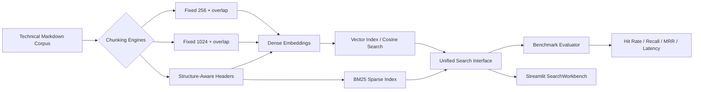

# Semantic Search Benchmarker — SearchWorkbench

A production-style information retrieval workbench that compares sparse BM25 keyword retrieval with dense semantic retrieval across multiple chunking strategies.

## Architecture



## What is being tested

The original Asteria Edge Gateway corpus contains exact identifiers such as `CUSTOM_CONFIG_FLAG_XYZ`, `ECONNRESET`, and `X-Asteria-Trace`, alongside conceptual operational guidance such as zero-downtime rollouts, secret rotation, socket starvation, and circuit breakers. The evaluation dataset contains 16 labeled queries split between exact lexical queries and conceptual paraphrases.

Ground truth is **not** tied to array positions or a particular chunk size. Each query maps to a stable section name and unique source phrase, so the same relevance label can be evaluated against 256-token, 1024-token, and structure-aware chunks without leakage.

## Chunking strategies

- `FixedSizeChunker(256, 32)` — higher granularity, more index entries, narrower local context.
- `FixedSizeChunker(1024, 128)` — broader context, fewer index entries, possible dilution of rare terms.
- `StructureAwareChunker()` — splits on Markdown headers while preserving fenced code blocks inside their parent sections.

## Retrieval methods

- **BM25**: `rank_bm25.BM25Okapi`, with identical normalization for documents and queries.
- **Dense**: `sentence-transformers/all-MiniLM-L6-v2` for real neural embeddings. Embeddings are normalized to unit length and searched with cosine similarity.
- **ChromaDB path**: `ChromaDenseIndex` stores explicit normalized vectors and converts Chroma cosine distance back into similarity (`1 - distance`).
- **Fast Local Demo**: deterministic semantic-hash encoder for offline QA only. It keeps tests and demos functional if a neural model cannot be downloaded.

## Setup

### Recommended: uv

```bash
uv venv --python 3.11
source .venv/bin/activate
uv pip install -e '.[dev]'
```

### Familiar pip/venv fallback

```bash
python3 -m venv .venv
source .venv/bin/activate
pip install -e '.[dev]'
```

## Run the UI

```bash
streamlit run src/app.py
```

If your environment does not place the project root on `sys.path`, use:

```bash
PYTHONPATH=. streamlit run src/app.py
```

The first MiniLM run downloads `sentence-transformers/all-MiniLM-L6-v2`. Use **Fast Local Demo** only when offline or validating UI behavior.

## Run tests

```bash
pytest -v
```

The test suite covers:

1. exact fixed-token overlap,
2. Markdown code-fence preservation,
3. BM25 rank-1 exact identifier retrieval,
4. dense paraphrase retrieval with a deterministic test encoder,
5. known Hit Rate / Recall / MRR math,
6. MRR misses outside K scoring zero.

## Benchmark configurations

The dashboard evaluates the same 16 labeled queries under:

| Configuration | Purpose |
|---|---|
| BM25 Baseline | Exact lexical retrieval on structure-aware sections |
| Dense 256 | High-granularity semantic chunks |
| Dense 1024 | Large-context semantic chunks |
| Dense Structure-Aware | Header-preserving semantic retrieval |

Run the dashboard benchmark with **MiniLM** and paste the resulting values into the table below before final submission/video:

| Configuration | Hit Rate@5 | MRR@5 | Avg Latency (ms) |
|---|---:|---:|---:|
| BM25 Baseline | 0.812 | 0.781 | 0.187 |
| Dense 256 | 0.938 | 0.773 | 12.012 |
| Dense 1024 | 0.312 | 0.171 | 10.434 |
| Dense Structure-Aware | 0.938 | 0.859 | 10.800 |

### Systems engineering reflection

BM25 should be expected to remain strong on rare identifiers, error codes, field names, and configuration flags because lexical term statistics reward exact overlap. Dense embeddings should be expected to help more on conceptual questions where the query vocabulary differs from the documentation. Neither method is universally superior; the correct choice depends on query distribution, latency budget, corpus size, and whether exact token identity is operationally important.

Chunking changes both recall and ranking behavior. Small chunks can isolate exact facts but lose surrounding context; large chunks preserve context but may dilute the embedding signal for a single configuration field. Structure-aware chunks preserve the author's semantic boundaries and are often a useful compromise for technical Markdown. The benchmark exists to replace assumptions with measured Hit Rate, MRR, and latency.

## AI audit

See [`ai_prompt_log.md`](ai_prompt_log.md) for the baseline generation prompt and five audited issues: cosine distance inversion, ground-truth leakage, BM25 tokenization asymmetry, code-fence splitting, and MRR math.

## Video checklist

- Show corpus + folder structure.
- Show fixed vs. structure-aware chunker code.
- Open `ai_prompt_log.md` and explain at least two before/after fixes.
- Search an exact identifier such as `CUSTOM_CONFIG_FLAG_XYZ`.
- Search a conceptual query such as `How can I deploy new versions without interrupting active traffic?`.
- Run the benchmark dashboard and compare Hit Rate / MRR / latency.
- Run `pytest -v` and show all tests passing.
